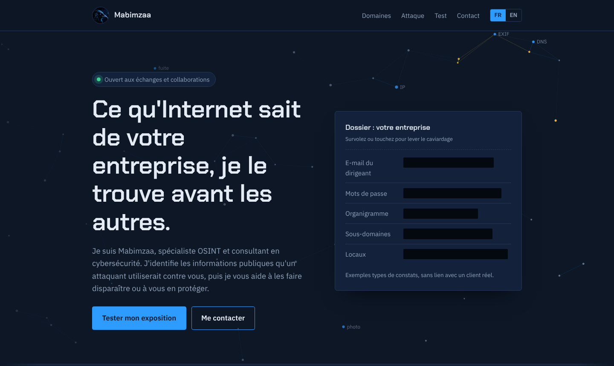
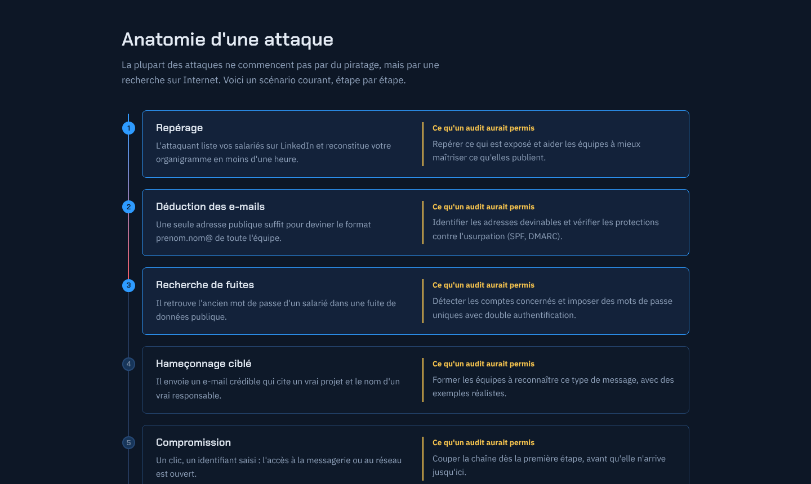
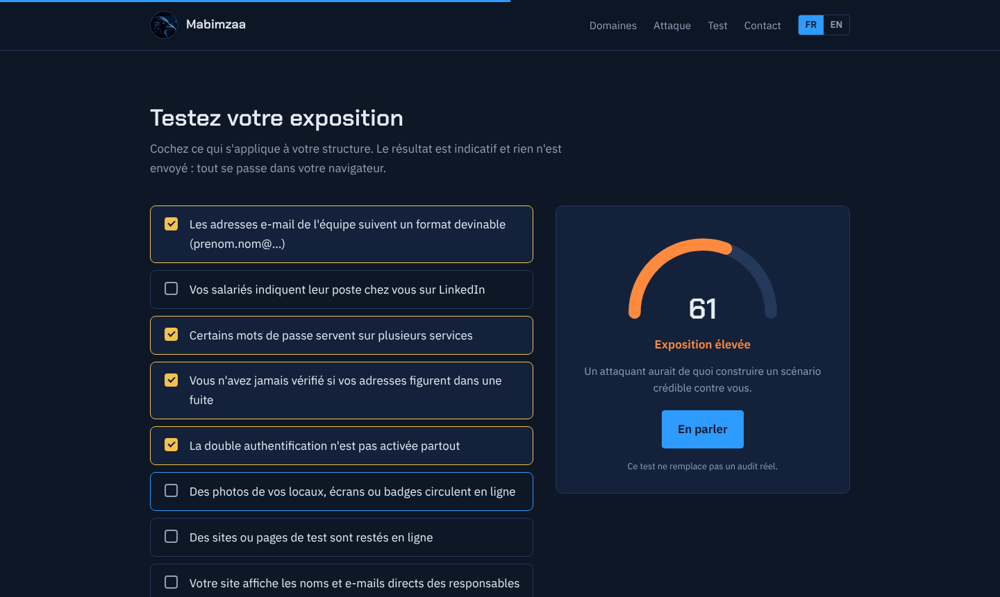
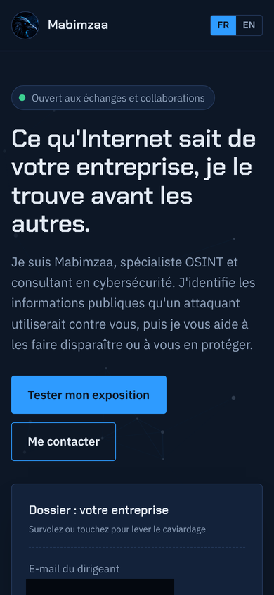

<p align="center">
  <a href="https://mabimzaa.github.io">
    
  </a>
</p>

<h3 align="center">
  <a href="https://mabimzaa.github.io">mabimzaa.github.io</a>
</h3>

<p align="center">
  Personal website of <b>Mabimzaa</b>, OSINT specialist and cybersecurity consultant.<br>
  Digital footprint audits, security testing and awareness training. French and English.
</p>

---

### What's on the site

| | |
|---|---|
| **Redacted case file** | The hero shows sample audit findings hidden under black bars. Hover or tap to lift the redaction. |
| **Live link graph** | An investigation-style graph of handles, emails, domains and breaches drifts behind the hero and lights up around the cursor. |
| **Anatomy of an attack** | Five steps from LinkedIn reconnaissance to compromise, lighting up as you scroll, each with what an audit would have done. |
| **Exposure self-check** | Eight questions and a live gauge from low to critical. Runs entirely in the browser: nothing is sent anywhere. |
| **Case 001** | A link to the OSINT challenge on [my GitHub profile](https://github.com/Mabimzaa). Solve it to join the hall of fame. |

<p align="center">
  
  
</p>

### Built with care for visitors

- **No tracking.** No analytics, no cookies, no forms. The only third-party request is Google Fonts.
- **Email hidden from scrapers.** The address never appears in plain text in the source. Visitors click *Reveal* and it decodes on screen.
- **Accessible.** Keyboard focus is visible everywhere, and heavy animations switch off for visitors who ask their system to reduce motion.
- **Responsive.** Designed down to phone width.
- **Bilingual.** French at the root, English under `/en/`, with `hreflang` tags so search engines serve the right language.

<p align="center">
  
</p>

### Structure

```
├── index.html             French home page
├── mentions-legales.html  French legal notice and privacy
├── en/
│   ├── index.html         English home page
│   └── legal.html         English legal notice and privacy
├── assets/
│   ├── style.css          All styles
│   ├── main.js            Effects and interactions (vanilla JS, no dependencies)
│   └── avatar.jpg
└── docs/                  Screenshots for this README
```

Plain HTML, CSS and JavaScript. No framework, no build step: GitHub Pages serves the files as they are.

### Run it locally

Clone the repository and open `index.html` in a browser, or serve the folder:

```bash
python -m http.server 8000
```

Then visit `http://localhost:8000`.

When you change `style.css` or `main.js`, bump the `?v=` number where they are linked in the four HTML pages, so returning visitors get the new version instead of a cached one.

### Contact

Through the [website](https://mabimzaa.github.io/#contact) or [GitHub](https://github.com/Mabimzaa).

### Rights

© Mabimzaa. All rights reserved. The text, visuals and code of this site may not be reused without written permission.

<details>
<summary><b>Version française</b></summary>
<br>

Site personnel de **Mabimzaa**, spécialiste OSINT et consultant en cybersécurité : audits d'empreinte numérique, tests de sécurité et sensibilisation, en français et en anglais.

**Au programme :** un dossier caviardé qui se dévoile au survol, un graphe d'enquête animé, une frise « Anatomie d'une attaque » qui s'allume au défilement, un test d'exposition avec jauge en direct (calculé dans le navigateur, rien n'est envoyé) et un lien vers l'énigme OSINT de mon [profil GitHub](https://github.com/Mabimzaa).

**Côté visiteurs :** aucun traceur, aucun cookie, aucun formulaire. L'adresse e-mail n'apparaît jamais en clair dans le code. Les animations lourdes se coupent si le système demande de réduire les animations, et le site est pensé pour mobile.

**Technique :** HTML, CSS et JavaScript sans framework ni étape de compilation. Pour tester en local, ouvrez `index.html` ou lancez `python -m http.server 8000`. Après une modification de `style.css` ou `main.js`, augmentez le numéro `?v=` dans les quatre pages HTML pour éviter les problèmes de cache.

**Droits :** © Mabimzaa, tous droits réservés.

</details>
